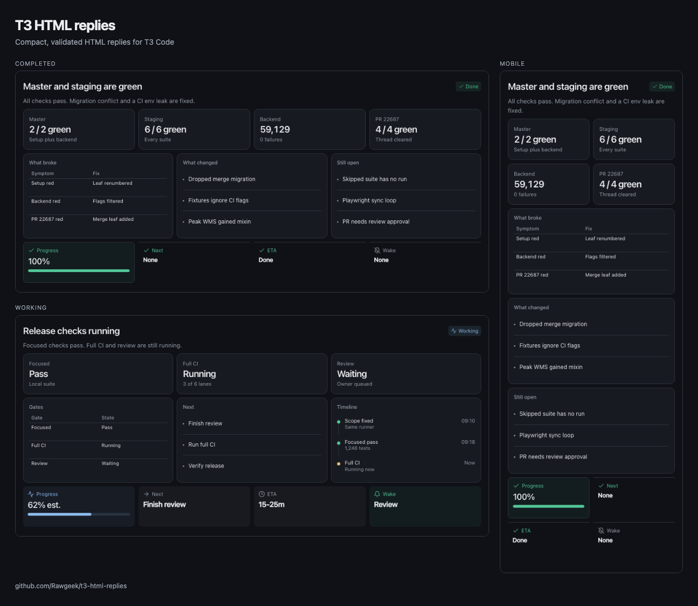
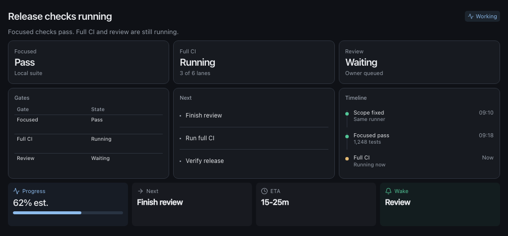
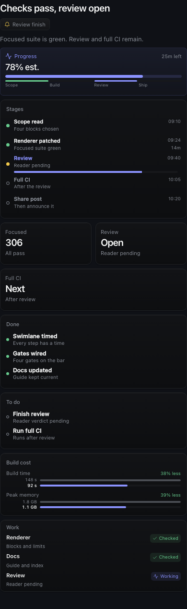
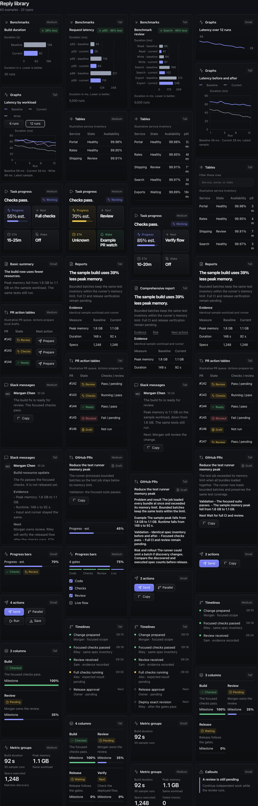

# T3 HTML replies

A Codex skill and UI kit for compact HTML replies in T3 Code.



The renderer turns short JSON into one self-contained HTML page. Replies use a dense grid, fixed 184px blocks, slim result and status tiles, and hard limits on text. There are no expandable sections or hidden content.

## What it does

- 3-column grid at 1024px, 2 columns on tablets, 1 on phones.
- Results and status use 88px tiles. Every reply section uses the same 184px height.
- 8 sections max, 3 items per block, 1,200 visible characters.
- 2-column tables, 3 rows. The last row fills automatically, so no orphan blocks.
- Progress bar stays inside the Progress tile.
- The renderer rejects long fields, unknown fields, mixed heights, and opaque IDs.

## Install

Clone the repo into your Codex skills directory:

```sh
git clone https://github.com/Rawgeek/t3-html-replies.git ~/.codex/skills/t3-html-replies
```

Then use `$t3-html-replies` in a T3 or Codex session.

Render an example:

```sh
cd ~/.codex/skills/t3-html-replies
node ui-library/ui.mjs reply ui-library/release-example.json output/release.html
```

Open `ui-library/index.html` for the full gallery.

## Optional MCP actions

The skill can use T3's `html_render` directly. For sendable action buttons, register the bundled stdio server in `~/.codex/config.toml`:

```toml
[mcp_servers.t3_html_replies]
command = "node"
args = ["/absolute/path/to/t3-html-replies/scripts/mcp-server.mjs"]
```

Restart the provider session after adding it.

## More examples

| Working reply | Mobile |
| --- | --- |
|  |  |



The gallery has 60 examples across 20 families: benchmarks, graphs, tables, task progress, reports, PR queues, Slack messages, GitHub PRs, progress bars, buttons, timelines, layouts, metrics, callouts, checklists, states, and status panels.

## Layout

```
SKILL.md                 Skill entrypoint
agents/openai.yaml       Skill metadata
assets/mcp-app.html      Native MCP app shell
scripts/                 MCP server and self-test
ui-library/              CSS, renderer, validator, gallery, examples
screenshots/             README examples
```

Inside `ui-library/`:

- `AGENT_GUIDE.md`: schema, limits, and layout rules.
- `ELEMENT_INDEX.md`: tree of all 60 examples.
- `index.html`: visual gallery.
- `render-reply.mjs`: validated reply renderer.
- `library.css`: shared styles and fixed heights.
- `verify.mjs`: validation and generated-file checks.
- `release-example.json`, `working-example.json`, `complete-example.json`: starting points.

## Develop

```sh
cd ~/.codex/skills/t3-html-replies
node ui-library/build.mjs
node ui-library/verify.mjs
node scripts/selftest.mjs
```

Generated gallery files, snippets, logic files, and preview templates are checked in so the repo works offline.

## License

MIT
