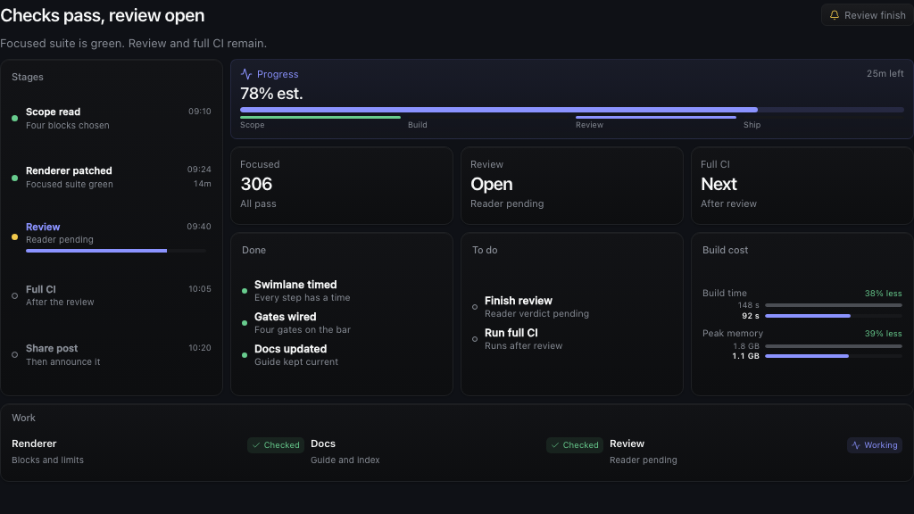
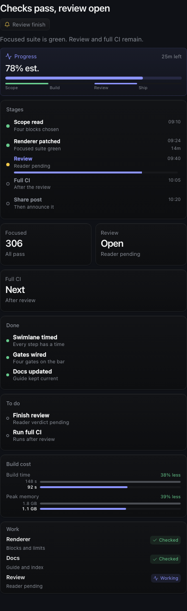
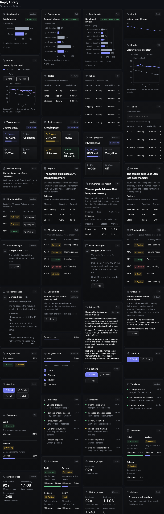

# T3 HTML replies

A Codex skill and UI kit for compact HTML replies in T3 Code.



The renderer turns short JSON into one self-contained HTML page. Replies use a dense bento grid, minimum-height blocks, slim result and progress tiles, and hard limits on text. There are no expandable sections, hover-only details, truncated text, or hidden content.

## What it does

- Four-column grid at 1024px: Stages hold the left column; Progress and evidence span the right three columns; Done, To do, and one supporting block share the next row.
- Progress and result facts use 88px minimum tiles. Supporting blocks use 184px minimum; a trailing row containing only facts, cards, or list items uses 88px minimum. Stages use 376px minimum. Rows grow only when accepted content needs another line. Below 900px the grid stacks with natural heights.
- Choose `replyType` first. `progress` preserves the existing task layout. `data` uses charts, tables, and short notes without task history.
- `interactive` delivers trusted custom HTML and local JavaScript in an isolated frame, for final outputs only.
- All replies allow 8 sections and 1,200 visible characters. Data and interactive replies also allow 90 words and 12 words per sentence.
- Only progress replies require stages, result facts, changes, and milestones.
- Numbers sit in a visual: compare bars for before and after, facts for single values, bars for groups.
- The renderer picks each block span, so the flow fills every cell with no orphan blocks or holes.
- Progress shows one segment per milestone, labelled under the track.
- The renderer rejects long fields, unknown fields, hidden table details, invalid clocks, missing descriptions, boolean bar values, hashes, and opaque IDs.

## Install

Clone the repo into your Codex skills directory:

```sh
git clone https://github.com/Rawgeek/t3-html-replies.git ~/.codex/skills/t3-html-replies
```

Then use `$t3-html-replies` in a T3 or Codex session.

Render an example:

```sh
cd ~/.codex/skills/t3-html-replies
node ui-library/ui.mjs reply ui-library/reply-example.json output/reply.html
```

Open `ui-library/index.html` for the full gallery.

Render a reply through the MCP tool with the JSON path, not HTML:

    {"dataPath": "/absolute/path/reply.json"}

## MCP app

The skill can use T3's `html_render` directly. Register the bundled app server in `~/.codex/config.toml`:

```toml
[mcp_servers.t3_html_replies]
command = "node"
args = ["/absolute/path/to/t3-html-replies/scripts/mcp-server.mjs"]
```

Restart the provider session after adding it.

Chat buttons and choices show a steering wheel icon. The installed T3 bridge hard-codes app messages to queue.
Those controls stay disabled and explain why. No message is queued. Functional steering requires a T3 host change.
HTTPS links, PRs, attachments, and local custom controls keep their own behavior.

Choose and render one type:

```sh
node ui-library/ui.mjs schema data
node ui-library/ui.mjs new data output/data.json
node ui-library/ui.mjs reply output/data.json output/data.html
```

With MCP, pass `dataPath` to `render_reply` instead of running `reply`. Both validate and render in one call.
Custom scripts are trusted agent-authored code. Layout audits detect mistakes; they do not contain hostile scripts or prevent self-navigation.

## More examples

| Waiting reply | Mobile |
| --- | --- |
|  |  |



Preview images are generated from the current renderer, so they cannot drift from the code.

## Layout

```
SKILL.md                 Skill entrypoint
agents/openai.yaml       Skill metadata
assets/mcp-app.html      Native MCP app shell
scripts/                 MCP server, self-test, preview capture
ui-library/              CSS, renderer, validator, gallery, examples
hooks/pre-commit         Regenerates README previews
screenshots/             Generated README previews
```

Inside `ui-library/`:

- `AGENT_GUIDE.md`: type selection. Read only the matching file in `guides/` for its schema.
- `ELEMENT_INDEX.md`: tree of all 60 examples.
- `index.html`: visual gallery.
- `render-reply.mjs`: validated reply renderer.
- `library.css`: shared styles and minimum heights.
- `verify.mjs`: validation and generated-file checks.
- `reply-example.json`, `complete-example.json`: starting points.

## Previews

The pre-commit hook rebuilds the library, runs verification and the MCP self-test, then regenerates `screenshots/overview.png`, `screenshots/reply-mobile.png`, and `screenshots/gallery.png`. It refuses to run when library inputs have unstaged changes, so previews always match the staged snapshot. It stages only generated outputs:

    git config core.hooksPath hooks
    node scripts/previews.mjs

Set `CHROME_PATH` when Chrome lives elsewhere. Skip it with `git commit --no-verify`.

## Develop

Use Node 22 or newer. Preview capture also needs Chrome; set `CHROME_PATH` when it is not in the default macOS location.

```sh
cd ~/.codex/skills/t3-html-replies
node ui-library/build.mjs
node ui-library/verify.mjs
node scripts/selftest.mjs
node scripts/layout-check.mjs
node scripts/types-check.mjs
```

Generated gallery files, snippets, logic files, and preview templates are checked in so the repo works offline.

## License

MIT
